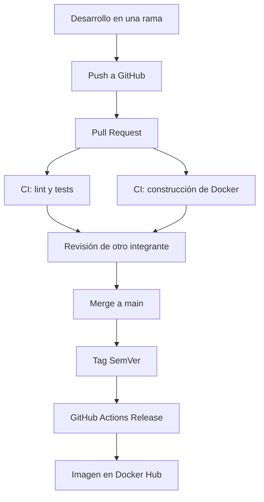

# Devops
[](https://github.com/Facuc123/Devops/actions/workflows/ci.yml)
Trabajo práctico Devops - Universidad de Palermo - Integrantes: Facundo Canto y Luciano Sicolo
## Estrategia de versionado

El proyecto utiliza Versionado Semántico (SemVer), siguiendo el formato
`MAJOR.MINOR.PATCH`:

- `MAJOR`: cambios incompatibles con versiones anteriores.
- `MINOR`: nuevas funcionalidades compatibles.
- `PATCH`: correcciones de errores compatibles.

Elegimos SemVer porque permite identificar claramente el impacto de cada
versión. Un SHA identifica un commit, pero no comunica el tipo de cambio
realizado. El versionado basado en fechas indica cuándo se publicó una versión,
pero tampoco permite saber si contiene una corrección, una funcionalidad nueva
o un cambio incompatible.

## Arquitectura y flujo de entrega

El proyecto utiliza ramas de corta duración. Cada cambio se desarrolla en una
rama independiente y se incorpora a `main` mediante un Pull Request aprobado.



El workflow de integración continua ejecuta el análisis de código con Ruff,
las pruebas automatizadas con Pytest y la construcción de la imagen Docker.
Los controles obligatorios y la revisión de otro integrante impiden integrar
cambios que no hayan sido verificados.

## API REST

La aplicación fue desarrollada con FastAPI y ofrece los siguientes endpoints:

| Método | Endpoint | Descripción |
|---|---|---|
| `GET` | `/health` | Comprueba que la API esté disponible |
| `GET` | `/status` | Informa los días sin incidentes y el récord histórico |
| `POST` | `/incidentes` | Registra un incidente |
| `GET` | `/incidentes` | Lista los incidentes registrados |
| `GET` | `/incidentes/{id}` | Obtiene un incidente por su identificador |
| `DELETE` | `/incidentes/{id}` | Elimina un incidente |
| `POST` | `/chaos/boom` | Genera una respuesta 500 controlada |
| `GET` | `/metrics` | Expone las métricas en formato Prometheus |
| `GET` | `/docs` | Muestra la documentación interactiva de OpenAPI |

El endpoint de caos está deshabilitado por defecto. Solo está disponible cuando
la variable `CHAOS_ENABLED` tiene el valor `true`.

## Docker

El `Dockerfile` utiliza una imagen base `python:3.12-slim`, que reduce el tamaño
de la imagen y contiene únicamente los componentes necesarios para ejecutar la
aplicación.

Se utiliza una construcción multi-stage:

1. La etapa `builder` crea el entorno virtual e instala las dependencias.
2. La etapa `runtime` copia únicamente el entorno y el código necesarios.

Las dependencias se copian antes que el código para aprovechar la caché de
Docker cuando el archivo `requirements.txt` no cambia. Además, la aplicación
se ejecuta con el usuario sin privilegios `appuser`, disminuyendo los riesgos
de seguridad dentro del contenedor.

El contenedor expone el puerto `8000` e incluye un `HEALTHCHECK` que consulta
el endpoint `/health`.

Para ejecutar el proyecto:

```bash
docker compose up --build
```

Después se puede acceder a la documentación en
`http://localhost:8000/docs`.

## Estrategia de ramas

Se utiliza una estrategia basada en ramas de corta duración:

- `main` contiene únicamente código revisado y estable.
- Cada funcionalidad utiliza una rama `feat/...`.
- Las correcciones utilizan una rama `fix/...`.
- Los cambios de documentación utilizan una rama `docs/...`.
- Todo cambio se integra mediante un Pull Request.
- `main` requiere una aprobación y los checks de CI exitosos.
- No se permiten pushes directos ni force-pushes a `main`.

Los commits siguen la convención Conventional Commits, por ejemplo:

```text
feat(api): agregar endpoint de estado
fix(chaos): respetar configuración de habilitación
docs(readme): ampliar informe técnico del proyecto
```

## Las Tres Formas de DevOps

### Primera Forma: flujo

El flujo desde el desarrollo hasta la publicación está automatizado. Cada Pull
Request ejecuta lint, tests y la construcción de Docker. Al crear un tag con
formato SemVer, el workflow de release construye y publica la imagen en Docker
Hub.

Docker permite utilizar el mismo entorno y las mismas dependencias durante el
desarrollo, la integración continua y la ejecución de la aplicación.

### Segunda Forma: retroalimentación

Los jobs de GitHub Actions entregan retroalimentación inmediata. Si Ruff,
Pytest o la construcción de Docker fallan, el Pull Request queda bloqueado y
no puede integrarse a `main`.

La API expone métricas en `/metrics` y Grafana Alloy las envía, junto con los
logs, a Grafana Cloud. El dashboard de Golden Signals permite detectar
respuestas 5xx y aumentos de latencia.

### Tercera Forma: aprendizaje continuo

El equipo realiza experimentos controlados para comprobar que los mecanismos
de protección y observabilidad funcionen correctamente:

- Se creó un Pull Request con una prueba rota intencionalmente para demostrar
  que la integración queda bloqueada.
- El endpoint `/chaos/boom` permite provocar una respuesta HTTP 500 controlada.
- Los resultados del experimento de observabilidad se documentarán cuando la
  integración con Grafana Cloud esté finalizada.

## Desperdicios Lean reducidos

### Defectos detectados tarde

Los tests y el análisis de Ruff se ejecutan automáticamente antes del merge.
Esto permite encontrar errores antes de que lleguen a `main`.

### Esperas y tareas manuales

GitHub Actions automatiza las verificaciones y la publicación de imágenes,
evitando que una persona tenga que ejecutar y subir cada versión manualmente.

### Diferencias entre entornos

Docker define la versión de Python, las dependencias y el comando de ejecución,
reduciendo los problemas ocasionados por configuraciones distintas entre las
computadoras de los integrantes y el entorno de CI.

## Observabilidad

### Logs

La aplicación genera logs estructurados en formato JSON con información como
fecha, nivel, método HTTP, ruta, código de estado, duración e identificador de
la solicitud (`X-Request-ID`).

### Métricas

El endpoint `/metrics` expone, en formato Prometheus, las métricas necesarias
para las Golden Signals:

| Métrica | Tipo | Labels | Golden Signal |
|---|---|---|---|
| `http_requests_total` | Counter | `method`, `route`, `status_code` | Tráfico y errores |
| `http_request_duration_seconds` | Histogram | `method`, `route` | Latencia |
| `http_requests_in_progress` | Gauge | `method` | Saturación |
| `app_info` | Gauge | `servicio`, `version`, `entorno` | Versión desplegada |

El label `route` usa la plantilla de la ruta (`/incidentes/{incidente_id}`) y
no la URL real, para que cada UUID no genere una serie nueva. Las rutas
inexistentes se agrupan en `sin_ruta` y `/metrics` no se mide a sí mismo.

### Envío a Grafana Cloud

[Grafana Alloy](https://grafana.com/docs/alloy/) consulta `/metrics` cada 15
segundos y lee los logs del contenedor de la API. Envía las métricas a
Prometheus y los logs a Loki en Grafana Cloud. La configuración está en
[`observability/config.alloy`](observability/config.alloy).

1. Copiar `.env.example` a `.env` y completar las variables `GRAFANA_CLOUD_*`
   con los datos del stack (grafana.com > stack > Prometheus / Loki >
   *Details*). El token es un *Access Policy token* con permisos
   `metrics:write` y `logs:write`.
2. Levantar la API junto con Alloy:

   ```bash
   docker compose --profile observability up --build
   ```

3. Verificar el estado de Alloy en `http://localhost:12345`.

Sin el perfil `observability`, `docker compose up` levanta solo la API y no
requiere credenciales.

### Dashboard de Golden Signals

El archivo
[`observability/dashboard-golden-signals.json`](observability/dashboard-golden-signals.json)
se importa en Grafana (*Dashboards > New > Import*) y muestra:

- Tráfico en solicitudes por minuto, total y por ruta.
- Latencia en percentiles p50 y p95.
- Respuestas 4xx y 5xx, y errores 5xx por ruta.
- Solicitudes en curso.
- Logs de error de la API desde Loki.

### Alertas sugeridas

| Alerta | Consulta PromQL | Condición |
|---|---|---|
| Tasa de 5xx alta | `sum(rate(http_requests_total{job="dias-sin-incidentes",status_code=~"5.."}[5m])) / sum(rate(http_requests_total{job="dias-sin-incidentes"}[5m]))` | `> 0.05` durante 2 min |
| Latencia p95 alta | `histogram_quantile(0.95, sum by (le) (rate(http_request_duration_seconds_bucket{job="dias-sin-incidentes"}[5m])))` | `> 0.5` durante 5 min |

### Experimento con `/chaos/boom`

Con `CHAOS_ENABLED=true`, el siguiente comando genera 50 respuestas 500 que
deben verse en el panel de errores 5xx y disparar la alerta de tasa de 5xx:

```bash
for i in $(seq 1 50); do curl -s -o /dev/null -X POST localhost:8000/chaos/boom; done
```

Los resultados del experimento se documentarán con capturas del dashboard.

> Los tokens y credenciales de Grafana Cloud y Docker Hub no se almacenan en
> este repositorio.
